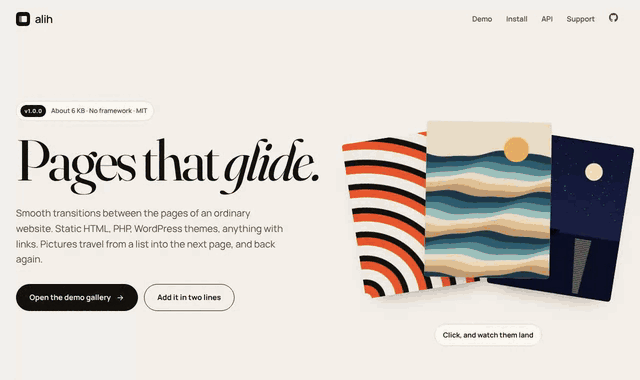
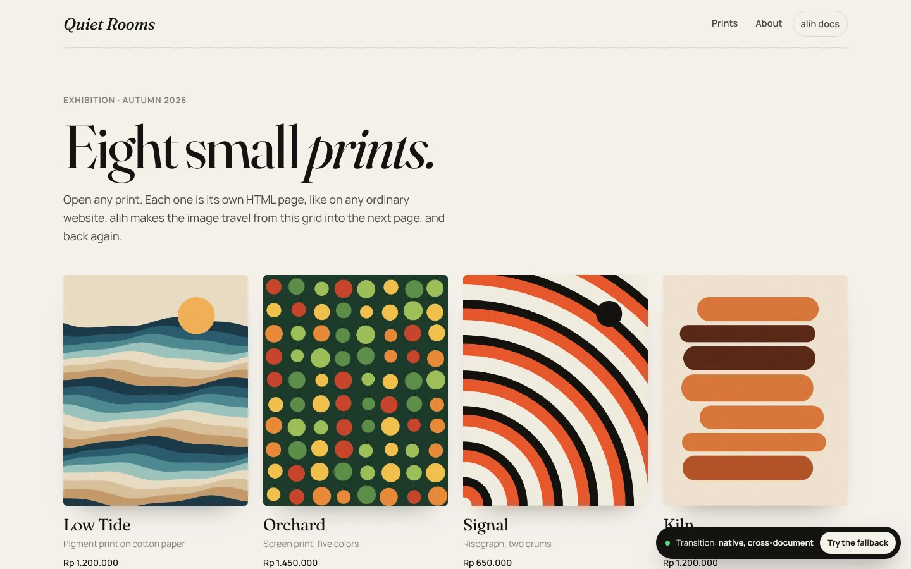
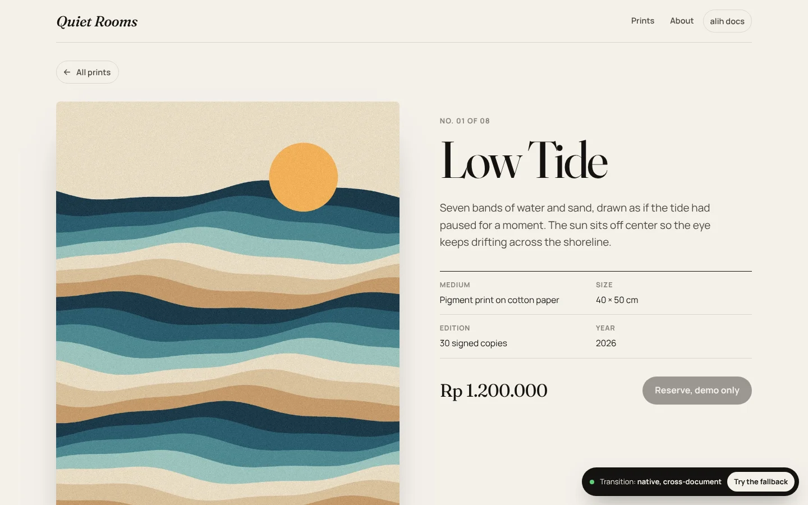
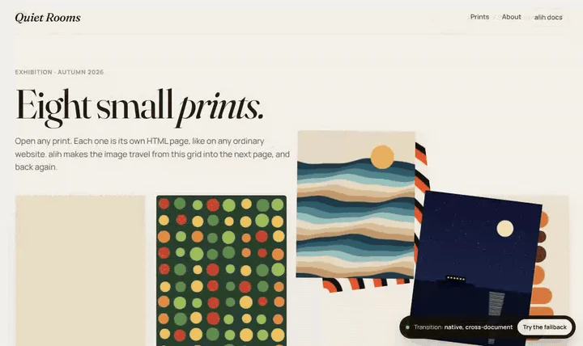

# alih

[](https://github.com/rezaaryam/alih/actions/workflows/test.yml)


Smooth page transitions for ordinary websites. Static HTML, PHP, WordPress themes, anything with links. Pictures travel from a list into the next page and back again, the way an app would do it, while every page stays a real page with a real URL.

*Alih* is Indonesian for "to shift".

**[Open the docs and the demo gallery](https://rezaaryam.github.io/alih/)**



## Two lines

```html
<link rel="stylesheet" href="https://rezaaryam.github.io/alih/alih.css">
<script src="https://rezaaryam.github.io/alih/alih.js"></script>
```

Put both in the `<head>` of every page. Keep the script in the head and do not defer it: in browsers with native transitions it has to listen before the first frame of the page.

Then mark what should travel. The same key on two pages makes the element morph:

```html
<!-- prints/index.html -->
<a href="low-tide.html">
  
  <h2 data-alih="title-low-tide">Low Tide</h2>
</a>

<!-- prints/low-tide.html -->

<h1 data-alih="title-low-tide">Low Tide</h1>
```

Only the card behind the link you followed is named, so a list with a hundred items stays fast.

## How it picks a path

| Browser | What happens |
|---|---|
| With cross-document view transitions (Chrome and Edge 126+, Safari 18.2+) | **Native.** The browser animates between pages by itself. alih names the shared elements in `pageswap` and `pagereveal`, sets the direction for Back and Forward, and adds speculation rules so hovered pages prerender. |
| Without them | **Soft.** Links are fetched in the background and the main content is swapped in place. Title, address bar, Back, and scroll position behave as usual. Shared elements still morph where `document.startViewTransition` exists. |
| Older browsers | **Soft with a fade.** A short fade between pages. |
| Anything goes wrong | alih steps aside and the browser loads the page normally. |
| Reduced motion turned on | No animation. |

Add `?alih=soft` to any URL to try the fallback in a browser that supports native transitions; the choice is kept for that tab. `?alih=auto` switches back.

<table>
  <tr>
    <td></td>
    <td></td>
  </tr>
  <tr>
    <td colspan="2"></td>
  </tr>
</table>

## Options

On the `<script>` tag:

| Attribute | Default | What it does |
|---|---|---|
| `data-mode` | `auto` | `auto`, `native`, `soft`, or `off` |
| `data-animation` | `slide` | `slide`, `fade`, or `none` for the page itself; shared elements always morph |
| `data-root` | `[data-alih-root], main` | What the soft fallback swaps |
| `data-prefetch` | `true` | Prerender (native) or prefetch (soft) a page when its link is hovered or touched |
| `data-manual` | off | Do not start on load; call `Alih.start(options)` yourself |

On links and elements:

| Attribute | What it does |
|---|---|
| `data-alih="key"` | Elements with the same key on two pages morph into each other |
| `data-alih-direction="back"` | Slide the other way, for links like "All prints". Real Back and Forward are detected on their own. |
| `data-no-alih` | Leave this link, or everything inside it, to the browser |
| `data-alih-root` | The part of the page that changes, for the soft fallback |
| `data-alih-skip` | On a `<script>` inside the swapped area: do not run it again after a swap |

In CSS: `--alih-duration`, `--alih-ease`, `--alih-shift`, and `--alih-bar` (the loading bar color in soft mode).

## JavaScript

```js
Alih.mode;                         // "native", "soft", or "off"
Alih.supports();                   // { crossDocument, sameDocument, fetch }
Alih.on("load", ({ url }) => {});  // soft mode: a new page was swapped in
Alih.on("start", (info) => {});    // { mode, direction, shared: [...keys] }
Alih.navigate("/prints/kiln.html");
```

The same events are dispatched on `document` as `alih:before`, `alih:start`, `alih:end`, `alih:load`, and `alih:error`.

In soft mode, scripts inside the swapped area run again after each swap. Scripts outside it (in the head, or after `main`) run once, so listen for `alih:load` if they need to update the new content.

## Server side

Nothing is required. In soft mode, requests carry an `X-Alih: 1` header, so a PHP site can send a lighter response if it wants to:

```php
if (($_SERVER['HTTP_X_ALIH'] ?? '') === '1') {
    // optional: skip analytics snippets or other work only needed on full loads
}
```

## The demo

`docs/demo/` is a fictional exhibition, Quiet Rooms: ten separate HTML files built by `scripts/build-demo.js`, with eight prints drawn by `scripts/make-art.py`. There is no router and no framework in the pages; alih is added with the two tags above. A switch in the corner shows the active mode and lets you compare.

## Development

```bash
npm install
npx playwright install chromium   # once
npm test                          # 18 tests: link rules and both modes in a real browser
npm start                         # docs and demo at http://localhost:3000
npm run demo                      # rebuild the demo pages
npm run sync                      # copy src/ into docs/ after changes
```

The browser tests check, among other things, that only the clicked card is named, that names are cleared after the transition, that Back reverses direction and restores scroll, that hovering prefetches so the click makes no second request, and that a broken link still loads normally.

## License

Code: MIT © Reza Arya Maulana. Fonts in `docs/fonts/` (Manrope, Fraunces) are under the SIL Open Font License. The prints are generated by the repository's own script.
